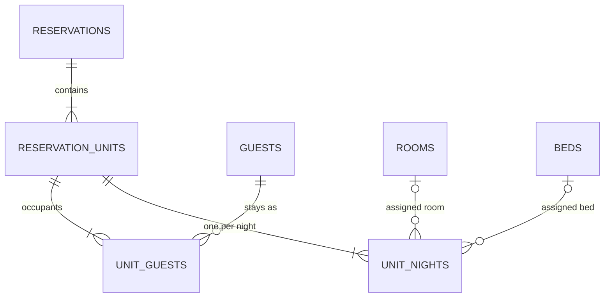

# Reservation shape

## Purpose

One structure for single rooms, groups and dorm beds.

## Core rule

**One reservation unit = one sellable room or bed.** There is no separate group table.

## Data model

```
reservations         id, property_id, reference, status (ReservationStatus),
                     booker_guest_id, company_id (nullable), group_name (nullable),
                     billing_mode (BillingMode), source (ReservationSource),
                     channel_name (nullable), external_reference (nullable),
                     notes (nullable text, up to 2000), created_by (FK users),
                     cancellation_requested_at, cancellation_requested_by (nullable),
                     timestamps
reservation_units    id, reservation_id, property_id, room_type_id, rate_plan_id,
                     arrival_date, departure_date, arrival_time, departure_time,
                     adults, children,
                     status (UnitStatus), discount_id (nullable),
                     late_arrival_expected, checked_in_at, checked_out_at,
                     stay_type (StayType, default Overnight), timestamps
unit_nights          id, reservation_unit_id, date, rate_plan_id,
                     room_id (nullable), bed_id (nullable),
                     base_amount, extra_amount, supplement_amount, discount_amount,
                     override_amount (nullable), amount
                     unique (reservation_unit_id, date)
                     check: room_id or bed_id, never both
unit_guests          id, reservation_unit_id, guest_id, is_primary
                     unique (reservation_unit_id, guest_id), one primary per unit
reservation_unit_children
                     id, reservation_unit_id, age
```



## Expected times

`arrival_time` and `departure_time` (`time`, not null) are the expected times of the unit. The booking form fills them from the property's `check_in_time` and `check_out_time`, and staff can change them per booking. They are not `checked_in_at` and `checked_out_at`, which stay the real times. They never change nights, prices, availability or the night audit: those use business dates only. A unit added later with `AddUnit` and no times copies them from the first unit of the reservation, and falls back to the property times when there is none.

## Enums

- `ReservationStatus`: Confirmed, InHouse, Completed, Cancelled.
- `UnitStatus`: Confirmed, CheckedIn, CheckedOut, Cancelled, NoShow (with `canTransitionTo()`).
- `BillingMode`: MasterPays, MasterPaysAll, EachPays.
- `ReservationSource`: Direct, WalkIn, Phone, Channel, Portal.

### Unit transitions

| From              | To                           |
| ----------------- | ---------------------------- |
| Confirmed         | CheckedIn, Cancelled, NoShow |
| CheckedIn         | CheckedOut                   |
| CheckedOut        | none                         |
| Cancelled, NoShow | Confirmed (reinstate)        |

### Reservation status

`ReservationStatus` is derived from the units, never set by hand. `ReservationStatus::fromUnits()` holds the rule and `SyncReservationStatus` stores it. A live unit is one that is not Cancelled or NoShow.

1. Every unit is Cancelled: Cancelled.
2. No live unit is left (only NoShow and Cancelled): Completed.
3. A live unit is CheckedIn: InHouse.
4. Every live unit is CheckedOut: Completed.
5. Anything else: Confirmed. A group with some units checked out and the rest still to arrive stays Confirmed.

It has no `canTransitionTo()` because nothing sets it by hand.

## Rules

- Room and bed assignment is per night, on `unit_nights`. A guest can move rooms mid-stay.
- `room_id` is for Room room types and `bed_id` is for Bed room types, never both. Both can be empty until the unit is assigned. A CHECK keeps the two apart. Only the assignment Actions can check the room type (a CHECK cannot read another table), so `AssignRoom`, `AssignBed` and `MoveUnit` verify that the room or bed belongs to the unit's room type and property.
- `reservation_units.property_id` repeats the reservation's property so availability and audit queries need no join. Actions set it from the reservation. `unit_nights`, `unit_guests` and `reservation_unit_children` have no `property_id` and no timestamps: they are scoped through their unit.
- A unit holds inventory on its `unit_nights` while it is Confirmed, CheckedIn or CheckedOut. Cancelled and NoShow units release their nights ([availability](../10-availability/01-availability-service.md)). When a unit is cancelled or marked no-show, its Action clears `room_id` and `bed_id`, so the room can be sold again.
- `reservation_unit_children.age` is from 0 to 17, and ages are always required when a unit has children. `AddUnit` checks them. The quote prices an age past the property's last age group as an adult.
- `unit_nights` stores the quoted amounts at booking. Rate changes do not change existing bookings. `discount_amount` is the rate plan's stay discount from the quote. A catalogue discount (`reservation_units.discount_id`) is not stored on the nights; the folio posts it.
- `amount` is `override_amount` when it is set, otherwise `base_amount + extra_amount + supplement_amount - discount_amount`. A CHECK enforces this. The quoted split stays as it was, so reports can show the quote and the override side by side. `override_amount` is set at booking, or later by [Change a night's price](09-change-night-price.md).
- A unit with `stay_type = DayUse` has `arrival_date = departure_date`, no `unit_nights` and one `unit_day_uses` row with its room, hours and price. See [Day use](10-day-use.md).
- `reservation_unit_children` holds one row per child, so the count always matches `children`. Extending a stay, changing plan or reinstating re-prices from these ages.
- Every action works on one unit. Group actions loop over units.
- `reference` comes from `document_sequences`.
- `company_id` is a nullable column without a foreign key until [Companies](../15-city-ledger/01-companies.md) adds the table and the key.
- `external_reference` holds the OTA booking number or the company reference (the company's voucher number).
- `cancellation_requested_*` is set only by a company user after the cancel cut-off (see [Company portal](../23-company-portal/01-company-portal.md)).
- Status transitions are one Action per transition, checked by `UnitStatus::canTransitionTo()`. Each one calls `SyncReservationStatus` afterwards.
- `MergeGuests` calls `RepointGuestReservations` (booker and unit guests), and `AnonymizeGuest` refuses an in-house guest through `GuestInHouse` (an occupant of a CheckedIn unit).
- `notes` holds the booking form's free text. The creation log records only that notes exist.
- The double-booking rule (one room or bed per night) is kept by `AssignRoom` and `AssignBed` from the [booking form](05-booking-form.md): they lock the room type row and check the nights. The partial unique indexes on `unit_nights (room_id, date)` and `(bed_id, date)` come with [Room and bed assignment](../18-front-desk/02-room-and-bed-assignment.md), because they need a way for cancelled units to release their rooms.

## Build status

| Part                                                                                          | Status                                                           |
| --------------------------------------------------------------------------------------------- | ---------------------------------------------------------------- |
| Tables, enums, models, factories, `SyncReservationStatus`                                     | Built                                                            |
| `AvailabilityService` counts booked units, `MergeGuests` and `AnonymizeGuest` hooks           | Built                                                            |
| `CreateReservation`, `AddUnit` (incl. bed lines), `UpdateReservationGroup`, `override_amount` | Built, see [Group bookings](02-group-bookings.md)                |
| `unit_add_ons`, `AddUnitAddOn`, `RemoveUnitAddOn`, `ChargeQuantityResolver`                   | Built, see [Add-ons](04-add-ons.md)                              |
| `AttachGuest`, `reservations.view`, `reservations.manage`                                     | Built, see [Reservation page](06-reservation-page.md#guests-tab) |
| `notes` column, `AssignRoom`, `AssignBed`                                                     | Built, see [Booking form](05-booking-form.md#build-status)       |
| Double-booking indexes on `unit_nights`                                                       | Room and bed assignment (module 18)                              |
| Check-in, check-out, cancel, no-show, reinstate, move                                         | Front desk (module 18)                                           |

## Lessons from wastays

- `bookings` had 101 columns and one room per booking (`booking_rooms` unique on `booking_id`).
- Groups used a separate `group_bookings` table copying reservation numbers and statuses.
- `check_in`/`check_out` were datetimes. Use dates plus `checked_in_at`/`checked_out_at`.
- `TransitionStatus` was 551 lines.
