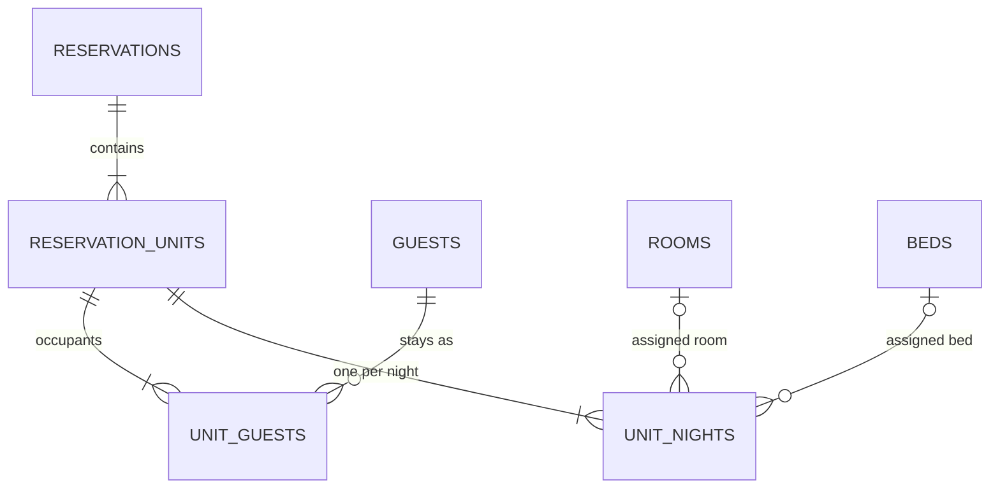

# Reservation shape

## Purpose

One structure for single rooms, groups and dorm beds.

## Core rule

**One reservation unit = one sellable room or bed.** There is no separate group table.

## Data model

```
reservations         id, property_id, reference, status (ReservationStatus),
                     booker_guest_id, company_id (nullable), group_name (nullable),
                     billing_mode (BillingMode), source (ReservationSource),
                     channel_name (nullable), external_reference (nullable),
                     created_by (FK users),
                     cancellation_requested_at, cancellation_requested_by (nullable),
                     timestamps
reservation_units    id, reservation_id, room_type_id, rate_plan_id,
                     arrival_date, departure_date, adults, children,
                     status (UnitStatus), discount_id (nullable),
                     late_arrival_expected, checked_in_at, checked_out_at, timestamps
unit_nights          id, reservation_unit_id, date, rate_plan_id,
                     room_id (nullable), bed_id (nullable),
                     base_amount, extra_amount, supplement_amount, discount_amount, amount
                     unique (reservation_unit_id, date)
                     check: bed_id is set for Bed room types
unit_guests          id, reservation_unit_id, guest_id, is_primary
reservation_unit_children
                     id, reservation_unit_id, age
```



## Enums

- `ReservationStatus`: Confirmed, InHouse, Completed, Cancelled.
- `UnitStatus`: Confirmed, CheckedIn, CheckedOut, Cancelled, NoShow (with `canTransitionTo()`).
- `BillingMode`: MasterPays, EachPays.
- `ReservationSource`: Direct, WalkIn, Phone, Channel, Agent.

## Rules

- Room and bed assignment is per night, on `unit_nights`. A guest can move rooms mid-stay.
- `unit_nights` stores the quoted amounts at booking. Rate changes do not change existing bookings.
- `reservation_unit_children` holds one row per child, so the count always matches `children`. Extending a stay, changing plan or reinstating re-prices from these ages.
- Every action works on one unit. Group actions loop over units.
- `reference` comes from `document_sequences`.
- `company_id` is a nullable column without a foreign key until [Companies](../15-city-ledger/01-companies.md) adds the table and the key.
- `external_reference` holds the OTA booking number or the agency's voucher number.
- `cancellation_requested_*` is set only by an agent after the cancel cut-off (see [Agent portal](../23-agent-portal/01-agent-portal.md)).
- Status transitions are one Action per transition, checked by `UnitStatus::canTransitionTo()`.

## Lessons from wastays

- `bookings` had 101 columns and one room per booking (`booking_rooms` unique on `booking_id`).
- Groups used a separate `group_bookings` table copying reservation numbers and statuses.
- `check_in`/`check_out` were datetimes. Use dates plus `checked_in_at`/`checked_out_at`.
- `TransitionStatus` was 551 lines.
