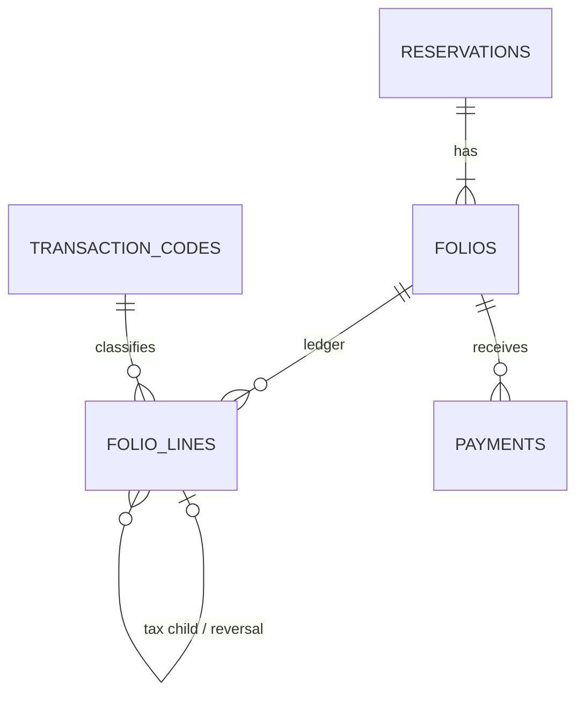

# Folios and ledger lines

## Purpose

The bill for a reservation, stored as an immutable ledger.

## Data model

```
folios         id, property_id, reservation_id, reservation_unit_id (nullable),
               number, type (FolioType), status (FolioStatus),
               payer_guest_id (nullable), payer_company_id (nullable),
               invoice_number (nullable), closed_at, closed_by, timestamps
               check: not both payer_guest_id and payer_company_id
folio_lines    id, folio_id, transaction_code_id, kind (TransactionKind), description,
               quantity, unit_amount, amount (signed), posting_date,
               source_type, source_id, parent_line_id (nullable),
               reversal_of_id (nullable), transfer_group_id (nullable),
               idempotency_key (unique), user_id, created_at
```



## Enums

- `FolioType`: Master, Unit.
- `FolioStatus`: Open, Closed, Voided.

## Rules

- **Signed amounts**: charges and taxes positive, payments negative. Balance = `SUM(amount)`. Not stored.
- **Immutable**: lines are never updated or deleted. Corrections are reversal lines (`reversal_of_id`).
- **Idempotent**: `idempotency_key` is unique, for example `night:{unit_night_id}`, `payment:{id}`, `addon:{id}`.
- Tax and discount lines are children of the charge (`parent_line_id`).
- Transfers are a reversal on the source plus a new line on the target, linked by `transfer_group_id`.
- `description` and `kind` are copied at posting time.
- Postings use the current business date, never the calendar date. Closed dates reject postings.
- A unit can check out only when its folio balance is 0 or transferred to the master folio.
- A reservation closes only when all its folios are closed.
- Closing a folio assigns `invoice_number` from `document_sequences`.

## Services and Actions

- `FolioBalance`
- `CloseFolio`, `ReopenFolio`

## Permissions

`folio.close`, `folio.reopen`.

## Lessons from wastays

`folio_transactions` had 49 columns, 5 expression indexes on `metadata->>` keys and 5 self-referencing FKs (parent, reversal, split, moved_from, voided_by). `booking_folios` had 45 columns.
