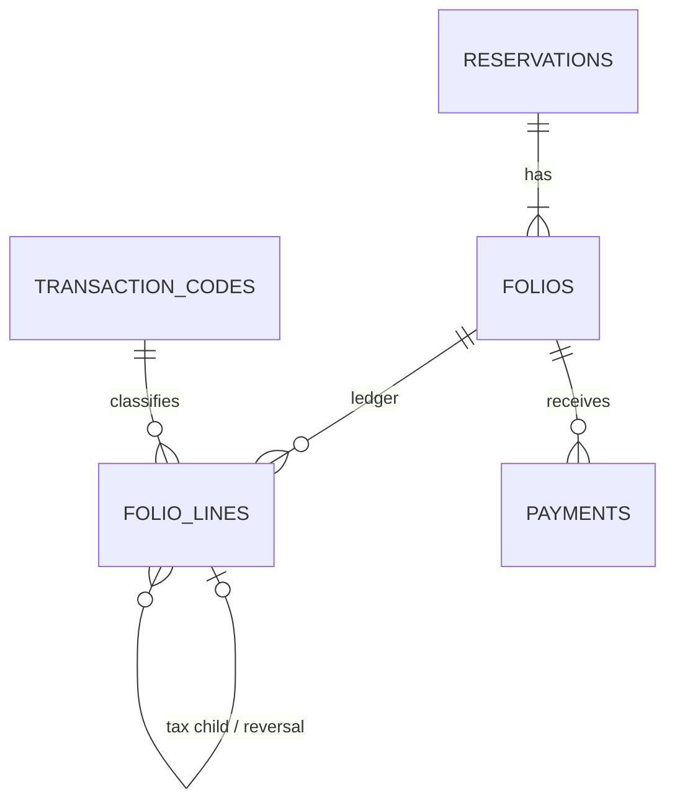

# Folios and ledger lines

## Purpose

The bill for a reservation, stored as an immutable ledger.

## Data model

```
folios         id, property_id, reservation_id, reservation_unit_id (nullable),
               number, type (FolioType), status (FolioStatus),
               payer_guest_id (nullable), payer_company_id (nullable),
               invoice_number (nullable), closed_at, closed_by, timestamps
               check: not both payer_guest_id and payer_company_id;
               (type = 'unit') = (reservation_unit_id is set); type has ThirdParty
folio_lines    id, folio_id, transaction_code_id, kind (TransactionKind), description,
               quantity, unit_amount, amount (signed), posting_date,
               source_type, source_id, parent_line_id (nullable),
               reversal_of_id (nullable), transfer_group_id (nullable),
               idempotency_key (unique), user_id, created_at
```



## Enums

- `FolioType`: Master, Unit, ThirdParty (added by [Routing](03-routing.md)).
- `FolioStatus`: Open, Closed, Voided.

## Rules

- A reservation has at most one active Master folio (partial unique index, Voided folios excluded) and any number of ThirdParty folios. A ThirdParty folio has no unit and its own payer. See [Routing](03-routing.md).
- **Signed amounts**: charges and taxes positive, payments negative. Balance = `SUM(amount)`. Not stored.
- **Immutable**: lines are never updated or deleted. Corrections are reversal lines (`reversal_of_id`).
- **Idempotent**: `idempotency_key` is unique, for example `night:{unit_night_id}`, `payment:{uuid}`, `addon:{id}`.
- Tax and discount lines are children of the charge (`parent_line_id`).
- Transfers are a reversal on the source plus a new line on the target, linked by `transfer_group_id`.
- `description` and `kind` are copied at posting time.
- **Source names the unit.** Every charge line sets `source_type` and `source_id` so the folio page can show its unit, also on a Master or Third party folio. A night and its inclusions name the unit night, an add-on names the add-on, and a manual charge or a policy fee names the reservation unit. A reversal and a transfer copy keep the source of their original line. A child line (tax, discount) has no source and takes its parent's. A payment has none. See [Posting charges](02-posting-charges.md#line-sources).
- Postings use the current business date, never the calendar date. Closed dates reject postings.
- A unit can check out only when its folio balance is 0 or transferred to the master folio.
- A reservation closes only when all its folios are closed.
- Closing a folio assigns `invoice_number` from `document_sequences`.
- `folio_lines` has no `property_id` and no `updated_at`. The folio scopes it.
- A database trigger rejects every `UPDATE` and `DELETE` on `folio_lines`, so immutability does not depend on code discipline.
- `payer_company_id` has no foreign key until module 15 adds companies.
- CHECK constraints: not both payers; a Unit folio has a `reservation_unit_id` and a Master folio has none; `closed_at` and `closed_by` are set together; `quantity` is at least 1; `source_type` and `source_id` are set together.
- `unit_add_ons.folio_line_id` (nullable, foreign key to `folio_lines`) marks a posted add-on.
- `MergeGuests` moves the folios a merged guest pays through `RepointGuestFolios`. `AnonymizeGuest` refuses a guest who pays a folio with a balance other than 0 (voided folios are skipped).

## Services and Actions

- `FolioBalance` (service, built): the balance of one folio, and whether a guest has an open balance.
- `RepointGuestFolios` (built): called by `MergeGuests`.
- `PostCharge`, `ReverseLine`, `TransferLines` (built): see [Posting charges](02-posting-charges.md).
- `CloseFolio`, `ReopenFolio` (built): see [Close and reopen](#close-and-reopen).
- `FolioInvoice` (service): prints a Closed folio with its `invoice_number`. See [Folio invoice](06-folio-invoice.md).
- `CreateFolio` (built): a unit folio is created the first time a unit receives a posting, by `PostCharge`. Nothing creates folios at booking time. See [Posting charges](02-posting-charges.md).

## Close and reopen

- `CloseFolio` refuses a folio that is not Open, a Master folio while one of its units is CheckedIn (`units_in_house`), and a balance other than 0. The in-house check runs before the balance check. Only the Master folio is checked: a Unit or ThirdParty folio closes while units are in-house. Closing changes the status only. Ledger lines are never touched.
- `CloseFolio` also refuses a folio that still receives Scheduled charges: a live unit (Confirmed or CheckedIn) routes Scheduled rows after the business date to it (`folio_receives_scheduled_charges`, from `IncomingScheduledCharges`). Closing it would make the next night audit fail those nights. The check runs after `units_in_house` and before the balance check, and applies to every close: check-out, a manual close and Settle to City ledger. The message names the rooms and dates and links to [Move charges](07-move-charges.md#scheduled-charges).
- `units_in_house` names the rooms: "Room 103 is still in-house. Check out all units first." (or "Rooms 103, 104 are still in-house. …"). A unit is named by tonight's room or bed ("Room 103", "Bed A1"), or by its room type when it has none. `InHouseUnits` (`app/Services/Folio/`) finds them, and `SettleToCityLedger` uses it too.
- **When to reopen.** Only to fix a guest's unit folio after check-out: a late charge (minibar, damage), a refund of an overpayment, or a reversal. A folio with an AR invoice never reopens: use a third-party folio sent to the company, or a credit note. The Master folio is not closed before Settle, so it has nothing to reopen.
- **Who may reopen.** `folio.reopen` (Owner, Manager, Finance) reopens any Closed folio without an AR invoice. A user with `front-desk.check-out` may also reopen a **Unit** folio closed during the current business date (`closed_at` on or after the business date's `opened_at`). Most late charges are found the same day; after the night audit the day is final and a manager reopens. `FolioReopenRule` (`app/Services/Folio/`) decides it for a user and a folio, and `ReopenFolio`'s route uses it.
- **The closed folio says what to do.** A Closed folio shows a notice above its rows (`FolioData.closedNotice`, from `FolioReopenRule`): "Closed at check-out today, 11:42. To add a charge, refund or fix a line, reopen it." with **Reopen folio** when the user may; "Closed at check-out yesterday. Ask a manager to reopen it." when not; "Billed to Acme Sdn Bhd on invoice F-0031. Use a third-party folio or a credit note." with an AR invoice. Post charge, Record payment and the row actions stay hidden on a Closed folio, so staff never meet a refusal after filling a form. The notice and the folio header carry **Print invoice** ([Folio invoice](06-folio-invoice.md)) for users with `folio.print-voucher`.
- `folio_not_open` (posting, payment, refund) says: "This folio is closed. Reopen it on the folio tab first, then try again." for a closed folio.
- `ReopenFolio` accepts a Closed folio only. A Voided folio cannot reopen. A folio with an AR invoice that is not Void cannot reopen (`folio_has_ar_invoice`, see [AR invoices](../15-city-ledger/02-ar-invoices.md)).
- Both are logged on the reservation. Both run in one transaction.
- Payments need `CloseFolio` first, so it lands before [Payments and refunds](../14-payments/01-payments-and-refunds.md).
- `invoice_number` is issued once, from the `Invoice` document sequence, at the first close. A reopened folio keeps it, and closing again issues no new number.
- Both Actions lock the folio row and return a `FolioStatusResult`. Refusal codes: `folio_not_open`, `units_in_house`, `folio_receives_scheduled_charges`, `balance_not_zero` (close) and `folio_not_closed` (reopen). A refusal writes and logs nothing.
- Logged on the reservation: `folio.closed`, `folio.reopened`.
- Defaults: `folio.close` for Owner, Manager, Front desk and Finance (check-out closes the unit folio itself); `folio.reopen` for Owner, Manager and Finance, plus the same-day Unit folio rule above for `front-desk.check-out`.
- Built in the folio tab: the Close and Reopen buttons ([Folio page](05-folio-page.md#build-status)). The in-house check for a Master folio comes with checklist item 21. A migration syncs the two permissions.

Decisions made at build time (checklist item 21, commit 2):

- A folio counts as closed "at check-out" when it closed within a minute of its unit's `checked_out_at`. A Unit folio closed by hand or by the auto-close afterwards reads "Closed today, 11:42.", "Closed yesterday." or "Closed on 5 Oct." (property time zone). Both end with the reopen sentence for the user.
- `folio_not_open` has one message for every Action that uses it (posting, payment, refund, discount, transfer, close of a closed folio): "This folio is closed. Reopen it on the folio tab first, then try again."
- The **Reopen folio** button moved from the folio header into the notice. `FolioStatement::build()` takes the user, because `canReopen` and `closedNotice` depend on `FolioReopenRule`.
- `CloseSettledUnitFolio` (`app/Actions/Folio/`) is the one place that closes a CheckedOut unit's folio at 0. `PostCharge`, `RecordPayment`, `RefundPayment`, `ReverseLine`, `TransferLines` (both folios), `ApplyDiscount` and `RemoveDiscount` call it last. The night audit postings never touch a CheckedOut unit.

## Permissions

`folio.close`, `folio.reopen`. Posting permissions are in [Posting charges](02-posting-charges.md).

## Lessons from wastays

`folio_transactions` had 49 columns, 5 expression indexes on `metadata->>` keys and 5 self-referencing FKs (parent, reversal, split, moved_from, voided_by). `booking_folios` had 45 columns.
