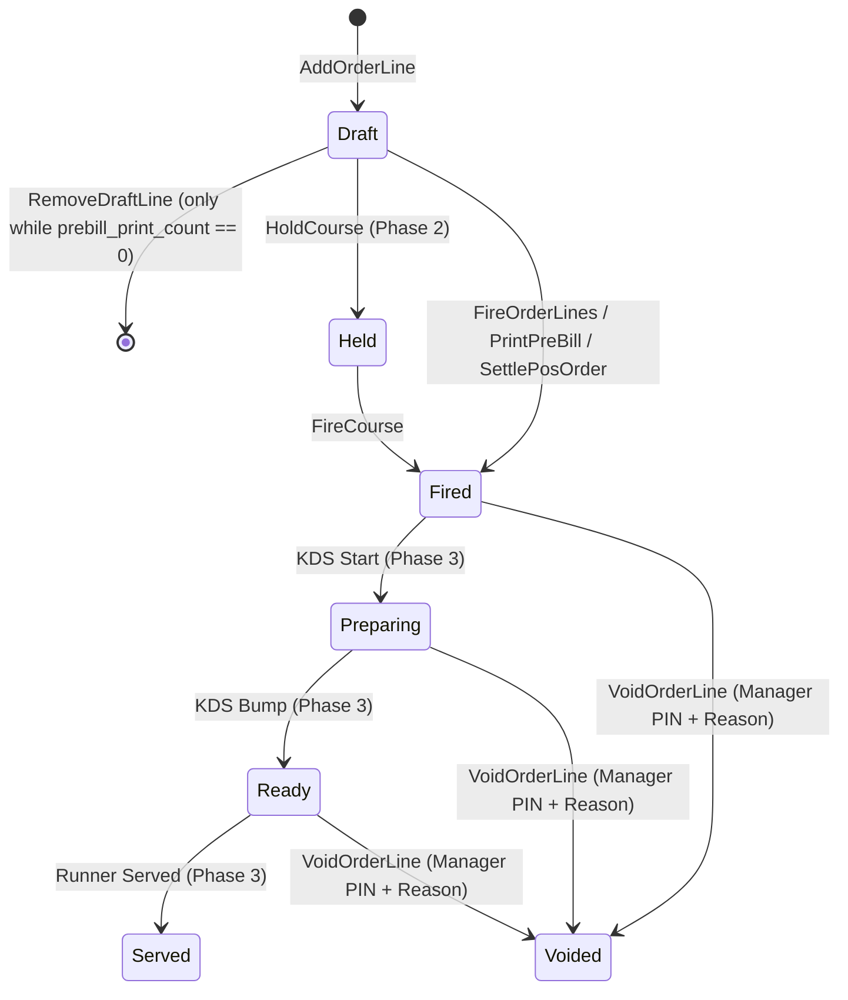

# Floors, tables, orders, splits and anti-fraud controls

> **Built (phases 1 to 3).** Part of [Native POS](01-overview.md). Defines `PayFirst` / `PayLater` outlet workflows, visual floor plans (Phase 2), order and kitchen line state machines, coursing, quantity splits, multi-bill ("AA") splits, discounts vs payment vouchers, and anti-fraud pre-bill & void controls.

## Purpose

Handle high-velocity counter service (Phase 1) and full-service hotel dining (Phase 2) reliably while closing real-world cashier fraud loopholes (pre-bill print-and-delete cash theft, silent post-kitchen deletions, unlogged reprints, and unauthorized comps).

## Outlet operation modes

Configured on `pos_outlets.operation_mode` (`PosOperationMode`):

- **`PayFirst`** (Phase 1 default — cafes, lobby kiosks, mini-marts, pool bars): Opens straight into the Order Screen with quick Dining Option pills. Payment settles the order and fires lines atomically.
- **`PayLater`** (Phase 2 — hotel restaurants, lounges, full-service dining): Opens into the **Floor Plan & Active Tabs** board. Waiters open a table/tab, add items, **Send/Fire** lines, print Pre-Bill (which locks lines), and settle later.

## Data model

> **Immutability rule:** Financial child tables (`pos_order_lines`, `pos_order_discounts`, `pos_order_payments`, `pos_order_folio_links`) use **`restrict`** foreign keys, never `cascade`. Money columns use `decimal(12,2)`. Phase-2/3 foreign keys (`pos_table_id`, `kitchen_station_id`) are added by their respective phase migrations.

### Phase 1 tables

```
pos_void_reasons        id, property_id, label (varchar 100),
                        requires_manager_pin (bool default true),
                        default_return_stock (bool default false),
                        sort_order (smallint default 0), active (bool default true), timestamps
                        UNIQUE (property_id, lower(label))

pos_orders              id, property_id, pos_outlet_id → pos_outlets (restrict),
                        pos_shift_id → pos_shifts (restrict, nullable -- null only for unattached Phase-3 QR orders until accepted into an open shift),
                        business_date (date, nullable -- NULL while Open; stamped with locked Open business_date at settlement OR void!),
                        synced_late (bool default false -- Phase 3: true when offline order synced after original shift closed),
                        client_uuid (uuid -- idempotency key; UNIQUE per property),
                        order_number (varchar 40, nullable -- assigned from document_sequences 'pos_order' at settlement),
                        order_type (PosOrderType: Sale|Refund, default Sale),
                        refund_for_order_id → pos_orders (restrict, nullable),
                        parent_order_id → pos_orders (restrict, nullable),
                        pos_dining_option_id → pos_dining_options (restrict),
                        reservation_unit_id → reservation_units (restrict, nullable),
                        guest_count (smallint default 1),
                        source (PosOrderSource: Terminal|TableQr|RoomQr, default Terminal),
                        status (PosOrderStatus: Open|Settled|Voided|Merged, default Open),
                        opened_by_user_id → users (restrict, nullable),
                        closed_by_user_id → users (restrict, nullable),
                        subtotal (decimal 12,2 default 0 -- sum of tax-exclusive net line amounts, including PackagingFee system line),
                        discount_total (decimal 12,2 default 0),
                        service_charge_total (decimal 12,2 default 0),
                        tax_total (decimal 12,2 default 0),
                        rounding_adjustment (decimal 12,2 default 0),
                        grand_total (decimal 12,2 default 0),
                        settled_on_folio (bool default false -- true when folio_posted_amount === grand_total),
                        folio_posted_amount (decimal 12,2 default 0 -- RoomCharge portion posted to guest folio(s)),
                        order_note (text, nullable),
                        prebill_print_count (smallint default 0),
                        receipt_claim_token (varchar 40, nullable, UNIQUE),
                        e_invoice_submission_id → e_invoice_submissions (restrict, nullable),
                        opened_at (timestamp), settled_at (timestamp, nullable),
                        voided_at (timestamp, nullable),
                        void_reason_id → pos_void_reasons (restrict, nullable),
                        void_reason_text (varchar 255, nullable),
                        voided_by_user_id → users (restrict, nullable),
                        void_approved_by_user_id → users (restrict, nullable),
                        timestamps
                        UNIQUE (property_id, client_uuid)
                        CHECK (folio_posted_amount >= 0 AND folio_posted_amount <= grand_total)
                        INDEX (property_id, pos_outlet_id, business_date, status)
                        INDEX (property_id, status)
                        -- Phase 2 migration adds: pos_table_id → pos_tables (restrict, nullable)

pos_order_lines         id, property_id, pos_order_id → pos_orders (restrict),
                        pos_item_variant_id → pos_item_variants (restrict, nullable -- null for system packaging fee line),
                        line_kind (PosOrderLineKind: Item|ComboComponent|PackagingFee, default Item),
                        price_includes_tax (bool default false -- snapshot of item's pricing authority; false for PackagingFee),
                        service_charge_exempt (bool default false -- true for PackagingFee and exempt items),
                        parent_combo_line_id → pos_order_lines (restrict, nullable),
                        refund_of_order_line_id → pos_order_lines (restrict, nullable -- exact original line lineage for refunds!),
                        transaction_code_id → transaction_codes (restrict),
                        is_entitlement_covered (bool default false -- covered at RM 0.00 by RedeemMeal),
                        meal_redemption_id → meal_redemptions (restrict, nullable),
                        item_name (varchar 140), variant_name (varchar 80),
                        internal_name (varchar 60, nullable),
                        quantity (decimal 10,3),
                        unit_price (decimal 12,2),
                        unit_cost (decimal 12,2, nullable),
                        line_gross (decimal 12,2 default 0),
                        discount_type (PosDiscountType, nullable),
                        discount_value (decimal 12,2, nullable),
                        discount_amount (decimal 12,2 default 0),
                        exclude_addons_from_discount (bool default false),
                        discount_reason (varchar 160, nullable),
                        discount_approved_by_user_id → users (restrict, nullable),
                        net_amount (decimal 12,2 default 0 -- always tax-exclusive & SC-exclusive net!),
                        service_charge_amount (decimal 12,2 default 0),
                        tax_amount (decimal 12,2 default 0),
                        line_total (decimal 12,2 default 0 -- net_amount + service_charge_amount + tax_amount),
                        course_number (smallint default 1),
                        seat_number (smallint, nullable),
                        kitchen_status (PosKitchenStatus: Draft|Held|Fired|Preparing|Ready|Served|Voided),
                        fired_at (timestamp, nullable),
                        preparing_at (timestamp, nullable),
                        ready_at (timestamp, nullable),
                        served_at (timestamp, nullable),
                        note (varchar 255, nullable),
                        void_reason_id → pos_void_reasons (restrict, nullable),
                        void_reason_text (varchar 255, nullable),
                        voided_by_user_id → users (restrict, nullable),
                        void_approved_by_user_id → users (restrict, nullable),
                        return_stock_on_void (bool default false),
                        timestamps
                        INDEX (pos_order_id, kitchen_status)
                        INDEX (refund_of_order_line_id)
                        -- Phase 3 migration adds: kitchen_station_id → pos_kitchen_stations (nullOnDelete, nullable)

pos_order_line_modifiers id, pos_order_line_id → pos_order_lines (restrict),
                        pos_modifier_option_id → pos_modifier_options (nullOnDelete, nullable),
                        option_name (varchar 100), internal_name (varchar 60, nullable),
                        price_delta (decimal 12,2 default 0),
                        charged_price (decimal 12,2 default 0 -- reflects free_included_count),
                        quantity (smallint default 1)

pos_order_discounts     id, property_id, pos_order_id → pos_orders (restrict),
                        discount_id → discounts (nullOnDelete, nullable),
                        name (varchar 100),
                        discount_type (PosDiscountType: FixedPercent|FixedAmount|VariablePercent|VariableAmount|FixedPrice|Foc),
                        value (decimal 12,2),
                        amount (decimal 12,2),
                        reason (varchar 160, nullable),
                        applied_by_user_id → users (restrict),
                        approved_by_user_id → users (restrict, nullable),
                        created_at (timestamp)
```

### Phase 2 floor plan tables

```
pos_floors              id, property_id, pos_outlet_id → pos_outlets (cascade),
                        name (varchar 80), sort_order (smallint default 0),
                        active (bool default true), timestamps
                        UNIQUE (pos_outlet_id, lower(name))

pos_tables              id, property_id, pos_floor_id → pos_floors (cascade),
                        code (varchar 20), label (varchar 40),
                        seats (smallint default 4),
                        shape (PosTableShape: Square|Round|Rect, default Square),
                        pos_x (smallint default 0), pos_y (smallint default 0),
                        width (smallint default 100), height (smallint default 100),
                        static_qr_token (varchar 32, nullable, UNIQUE),
                        active (bool default true), timestamps
                        UNIQUE (pos_floor_id, upper(code))
                        -- Note: dynamic QR tokens live ONLY in pos_qr_sessions (Phase 3), never duplicated here!
```

## Order & kitchen line state machines



- **Basic `FireOrderLines` lives in Phase 1**: Transitions `Draft` lines to `Fired`, stamps `fired_at`, and atomically decrements `stock_countdown` / `shared_stock_count`. Phase 3 hooks kitchen station dockets & KDS version bumps onto the same Action.
- **Draft vs Fired visual distinction**: `Draft` lines show a `warning` indicator and may be edited/deleted freely **only before firing or printing a pre-bill**. Once `Fired`, lines render in standard foreground text and are locked against silent deletion.

## Floor plan, splits & merges (Phase 2)

- **Batch table creation (`BatchCreatePosTables`)**: Prefix (`A`), start (`1`), end (`12`), seats (`4`), floor (`Indoor`) creates `A01`–`A12` in one action.
- **Live table tile state (`TableFloorState`)**: Vacant vs Occupied (elapsed time, cover count, running total, pre-bill badge, and multi-bill badge when ≥2 open orders sit on one table).
- **Split item quantity (`SplitOrderLineQuantity`)**: Breaks `3× Teh Tarik` into `1×` + `2×` preserving `kitchen_status` and `fired_at` without duplicating kitchen dockets.
- **Move / AA split (`MovePosOrderItems`, `SplitPosOrder`)**: Moves chosen lines (or splits evenly/by seat) onto a new open check on the same or another table (`parent_order_id`). Settling a table with ≥2 open orders displays a confirmation selector listing each check's open time and total.
- **Merge (`MergePosOrders`)**: Reassigns non-voided lines to target check, marks source `Merged`, recalculates totals, logs `pos.order_merged`.

## Discounts vs Payment Vouchers

| Mechanism                                                                                                                      | Tax treatment                                                                                                   | Reported under  | Controls                                                                                                                                                                        |
| ------------------------------------------------------------------------------------------------------------------------------ | --------------------------------------------------------------------------------------------------------------- | --------------- | ------------------------------------------------------------------------------------------------------------------------------------------------------------------------------- |
| **Item Discount** (`PosDiscountType`: `FixedPercent \| FixedAmount \| VariablePercent \| VariableAmount \| FixedPrice \| Foc`) | Pre-tax (reduces line net before SC & tax)                                                                      | Discounts       | Optional **`exclude_addons_from_discount`** toggle. Restricted/variable discounts & FOC require `pos.discount` Manager PIN.                                                     |
| **Bill Discount** (`pos_order_discounts`)                                                                                      | Pre-tax (pro-rated across non-voided, non-entitlement lines before SC & tax; last line absorbs 1-sen remainder) | Discounts       | Catalog `Discount` presets or PIN-gated variable discounts.                                                                                                                     |
| **Payment Voucher** (`PosTenderType::PaymentVoucher`)                                                                          | **Post-tax** (applied as tender against `grand_total`; preserves full SST taxable base)                         | Payment Summary | External/partner voucher tender (optional unique `reference` check per property). An internal prepaid voucher issuance/balance liability ledger is out of scope for Phases 1–3. |

## Anti-fraud controls

- **Default void reasons:** the first time an outlet is turned on for a property that has no void reasons, `SeedPosVoidReasons` creates four: _Wrong item entered_ and _Out of stock_ (no manager, stock goes back), _Kitchen error_ (no manager) and _Guest changed mind_ (manager PIN). A property that already has reasons is left alone.

1. **Pre-Bill Locks Lines, Discounts, Dining Options & Splits (`PrintPreBill` — closes all pre-bill skimming paths!)**:
    - Printing the first pre-bill automatically **fires and locks all remaining `Draft` lines** on the order (`FireOrderLines`) before incrementing `prebill_print_count` to `1`.
    - Once `prebill_print_count >= 1`:
        - **Line void/reduction**, **applying ANY discount** (even preset non-restricted discounts), AND **changing `pos_dining_option_id`** (e.g. switching Dine-In → Takeaway to drop 10% Service Charge!) all require a `pos.void` / `pos.discount` Manager PIN and write to `activity_log`.
        - **Splitting or moving lines** to a new/target order **inherits `max(target.prebill_print_count, source.prebill_print_count)`** so lines can never escape pre-bill PIN lock by moving to a fresh check!
    - When `pos_outlets.require_reprint_pin = true`, every subsequent pre-bill reprint (`prebill_print_count >= 1`) requires a `pos.void` Manager PIN and logs `pos.prebill_reprinted`.
2. **Post-Fire Void (`VoidOrderLine` / `VoidPosOrder`)**:
    - Once any line is `Fired` (or `prebill_print_count >= 1`), removing/reducing it requires `pos.void` (or action-bound Manager PIN override), mandatory `void_reason_id`, and `return_stock_on_void` toggle.
    - `VoidPosOrder` stamps `business_date = OpenPosBusinessDate` (so daily void reports always include voided orders on the correct trading date!).
    - Phase 3 dispatches a **`VoidDocket`** to the originating kitchen station(s) and marks the line voided on KDS.
3. **Immutable Audit Trail**: Every void, FOC comp, discount override, pre-bill reprint, tender swap and drawer open writes to `spatie/laravel-activitylog` with both `acted_by_user_id` and `approved_by_user_id`.
