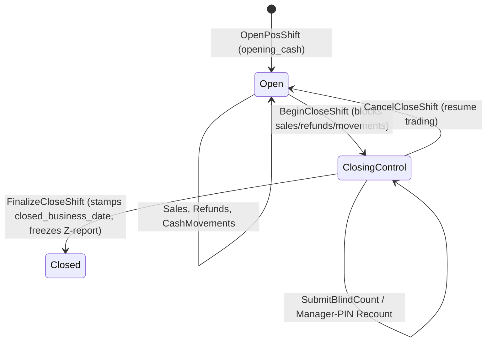

# Shifts, 2 AM rollover, accounting journal and LHDN e-invoicing

> **Built (phases 1 to 3).** Part of [Native POS](01-overview.md). Defines register shifts (`Open → ClosingControl → Closed` with cancel/recount), deadlock-free 2 AM rollover, balanced double-entry Daily Accounting Journal (including cash variance, payouts, refunds and a complete worked cross-midnight acceptance example), and Phase-1 LHDN consolidation + individual issuance + Phase-2 receipt QR self-claim.

## Data model

> **Migration conventions (`.ai/rules/migrations.md`):** Financial tables use **`restrict`** foreign keys. `z_report_snapshot` is allowlisted as a frozen issued-document snapshot. All money columns use `decimal(12,2)`.

```
pos_registers           id, property_id, pos_outlet_id → pos_outlets (restrict),
                        name (varchar 80), active (bool default true), timestamps
                        UNIQUE (pos_outlet_id, lower(name))
                        -- Phase 4 migration adds: receipt_printer_id, ecr_terminal_ip, ecr_terminal_port

pos_shifts              id, property_id, pos_outlet_id → pos_outlets (restrict),
                        pos_register_id → pos_registers (restrict),
                        opened_business_date (date -- informational open label; never blocks settlement),
                        closed_business_date (date, nullable -- accounting date where cash_variance posts at close!),
                        shift_number (varchar 40 -- via document_sequences 'pos_shift'),
                        status (PosShiftStatus: Open|ClosingControl|Closed, default Open),
                        opened_by_user_id → users (restrict),
                        closed_by_user_id → users (restrict, nullable),
                        opening_cash (decimal 12,2),
                        cash_payments (decimal 12,2 default 0),
                        cash_refunds (decimal 12,2 default 0),
                        paid_in (decimal 12,2 default 0),
                        paid_out (decimal 12,2 default 0),
                        expected_cash (decimal 12,2, nullable),
                        counted_cash (decimal 12,2, nullable),
                        recount_count (smallint default 0),
                        cash_variance (decimal 12,2, nullable),
                        opened_at (timestamp), closed_at (timestamp, nullable),
                        closing_note (text, nullable),
                        z_report_snapshot (jsonb, nullable -- allowlisted frozen Z-report),
                        timestamps
                        UNIQUE (pos_register_id) WHERE status <> 'closed'
                        INDEX (property_id, closed_business_date, status)

pos_cash_movements      id, property_id, pos_shift_id → pos_shifts (restrict),
                        business_date (date -- current open business date when recorded),
                        idempotency_key (varchar 120),
                        kind (PosCashMovementKind: FloatIn|SafeDrop|Payout|NoSaleOpen),
                        counter_transaction_code_id → transaction_codes (restrict, nullable -- e.g. Petty Cash Expense for Payout, Safe Clearing for SafeDrop/FloatIn),
                        amount (decimal 12,2 default 0),
                        reason (varchar 200),
                        user_id → users (restrict),
                        approved_by_user_id → users (restrict, nullable),
                        created_at (timestamp)
                        UNIQUE (property_id, idempotency_key)
                        CHECK (amount >= 0)

e_invoice_submission_pos_orders
                        id, e_invoice_submission_id → e_invoice_submissions (restrict),
                        pos_order_id → pos_orders (restrict),
                        is_active (bool default true -- set false when submission is Rejected/Cancelled so order can refile!),
                        line_number (int unsigned),
                        timestamps
                        UNIQUE (pos_order_id) WHERE is_active = true
                        INDEX (e_invoice_submission_id)
```

## Shift lifecycle & hardened blind cash control



1. **Open (`OpenPosShift`)**: Requires `pos.shift` and `OpenPosBusinessDate` (`status === Open`). Defaults `opening_cash` to the register's previous closed shift `counted_cash`. If the cashier starts with a different float (e.g., previous shift closed at RM 254.00 and new shift opens at RM 200.00), `OpenPosShift` atomically writes a `SafeDrop` (RM 54.00) or `FloatIn` cash movement against the outlet's Safe/Bank Clearing code so zero cash goes unaccounted between shifts!
2. **Cash Movements (`RecordCashMovement`)**: Allowed **only while shift is `Open`** (blocked in `ClosingControl`/`Closed`). Acquires `OpenPosBusinessDate` (`status === Open`), requires `(property_id, idempotency_key)` and `pos_shifts::lockForUpdate()`. `counter_transaction_code_id` is **mandatory** for `FloatIn`, `SafeDrop`, and `Payout` (nullable ONLY for `NoSaleOpen`). `NoSaleOpen` requires `pos.void` PIN + reason.
3. **Begin Close (`BeginCloseShift`)**: Refuses (`open_orders_exist`) if open orders remain on this register (staff settle, void, or transfer them via `TransferOrderToRegister`). Moves `Open → ClosingControl`, **blocking all sales, refunds, and cash movements** on this register during counting. `CancelCloseShift` returns `ClosingControl → Open` if needed.
4. **Two-Step Blind Count & Finalize (`SubmitBlindCount` → `FinalizeCloseShift`)**:
    - Live `expected_cash` is hidden from anyone without `pos.reports` (`pos.view` does NOT expose expected cash).
    - `cash_payments = SUM(amount + rounding_adjustment)` where `direction = In`, `tender_type = Cash`, `status = Captured`.
    - `cash_refunds = SUM(amount + rounding_adjustment)` where `direction = Out`, `tender_type = Cash`, `status = Captured`.
    - `expected_cash = opening_cash + cash_payments - cash_refunds + paid_in - paid_out`.
    - Cashier submits `counted_cash` (`SubmitBlindCount`, `recount_count = 1`) while shift remains in `ClosingControl`. If variance exceeds tolerance, manager enters PIN (`pos.reports`) to allow one recount (`recount_count = 2`, both logged).
    - `FinalizeCloseShift` acquires **`OpenPosBusinessDate` (`status === Open`, NOT `CurrentBusinessDate::date()` which returns `Auditing`!)**, stamps `closed_business_date`, freezes `z_report_snapshot`, and moves to `Closed`.

## Unified `OpenPosBusinessDate` Lock Protocol & 2 AM Rollover

Because `CurrentBusinessDate::date()` intentionally returns either `Open` or `Auditing` (while `ClaimBusinessDate` locks the `properties` row exclusively during Night Audit):

- **Every journal-affecting POS write** (`SettlePosOrder`, `RefundPosOrder`, `RecordCashMovement`, `FinalizeCloseShift`, `VoidPosOrder`, `OpenPosShift`) calls one shared service **`OpenPosBusinessDate`** inside its DB transaction:
    1. Acquires **`Property::whereKey($property->id)->sharedLock()->first()`** (multiple tills run concurrently without queuing behind each other, while cleanly serializing against `ClaimBusinessDate`'s exclusive `lockForUpdate()`!).
    2. Queries `business_dates` for the current date and requires **`status === BusinessDateStatus::Open`** — refusing with **`409 business_date_auditing`** (client retries automatically after 1–2s) if Night Audit is actively closing the outgoing date!
    3. **Global lock order** (deadlock-free): `properties (shared)` → `business_dates` → `reservation_units (asc id)` → `pos_orders` → `pos_shifts`.
- `pos_orders.business_date` stays `null` while `Open` and is stamped at settlement or void; shifts spanning 2 AM settle late orders onto the new `Open` date and stamp `closed_business_date` at finalization.

## Mandatory GL configuration & Double-entry Daily Accounting Journal

### Mandatory Transaction Codes (validated before enabling features — prevents journal export failures!)

- When `pos_outlets.native_pos_enabled = true`: **`cash_variance_transaction_code_id`** is required.
- When `rounding_mode !== None`: **`rounding_transaction_code_id`** is required.
- When any dining option has `apply_service_charge = true`: **`service_charge_transaction_code_id`** is required.
- When any dining option has `packaging_fee > 0`: **`packaging_transaction_code_id`** is required.
- The service charge and packaging fee codes must be **charge** codes (`charge_code_required`): a room charge posts them on the guest folio, and the folio only takes charge codes. The menu category and item accounts follow the same rule (`transaction_code_invalid`). The settings pickers list charge codes only for these fields. The cash rounding, cash variance and safe clearing accounts reach the daily journal only and may be any code.
- Every `pos_outlet_payment_methods` row requires a `payment_method_id` linked to an active `TransactionCode`.
- Every `FloatIn`, `SafeDrop`, and `Payout` requires a non-null `counter_transaction_code_id`.

Updates `App\Services\Accounting\BuildDailyJournal`:

1. **Always includes recorded POS activity regardless of current `NativePos` flag state** (so deactivating `NativePos` never loses historical days).
2. **Combines `$folioRows` + `$posRows` BEFORE checking `if ($rows === []) return null;`** (fixes café-only days with zero room activity!).
3. **Self-balancing POS double-entry rules (`SUM(posDebits) === SUM(posCredits)` asserted before merging — POS errors NEVER leak into `Guest ledger`)**:

| Event on `$date`                                                                      | Debit                                                                                                                                    | Credit                                                                                                                                        |
| ------------------------------------------------------------------------------------- | ---------------------------------------------------------------------------------------------------------------------------------------- | --------------------------------------------------------------------------------------------------------------------------------------------- |
| **Walk-in Sale** (`walk_in_share = grand_total - folio_posted_amount > 0`)            | Payment Method Clearing (`amount + rounding_adjustment` for Cash/Card/DuitNow/EWallet/Voucher; Rounding negative → Dr Rounding Variance) | Category Revenue GL + Service Charge GL + Packaging GL + Tax Payables (pro-rated to walk-in share) + Rounding positive → Cr Rounding Variance |
| **Walk-in Refund** (`order_type = Refund`, `direction = Out`)                         | **Reverses revenue & tax**: Dr Category Revenue GL + Dr Service Charge GL + Dr Tax Payables (walk-in share)                              | Cr Payment Method Clearing (`amount + rounding_adjustment` paid out; Cash rounding sign inverted symmetrically)                               |
| **Cash Shortage** (`cash_variance < 0` on shifts with `closed_business_date = $date`) | **Dr Cash Over/Short Variance** (`abs(variance)`)                                                                                        | **Cr Cash Clearing** (`abs(variance)`) — reduces book cash to physical counted cash!                                                          |
| **Cash Overage** (`cash_variance > 0` on shifts with `closed_business_date = $date`)  | **Dr Cash Clearing** (`variance`)                                                                                                        | **Cr Cash Over/Short Variance** (`variance`)                                                                                                  |
| **Cash Payout** (`Payout` movement on `$date`)                                        | **Dr Expense / Petty Cash GL** (`counter_transaction_code_id`)                                                                           | **Cr Cash Clearing** (`amount`)                                                                                                               |
| **Float In / Safe Drop** (`FloatIn` / `SafeDrop` on `$date`)                          | `SafeDrop`: Dr Safe/Bank Clearing; `FloatIn`: Dr Cash Clearing                                                                           | `SafeDrop`: Cr Cash Clearing; `FloatIn`: Cr Safe/Bank Clearing                                                                                |

### Worked End-to-End Acceptance Test (Mixed Cash/Room + Partial Refund + 2 AM Rollover + RM 2 Shortage)

- **Setup**: Food 100% exclusive (`++`), 10% SC (`service_charge_taxable = false`), 6% SST. Opening float `RM 200.00` on `2026-11-23`.
- **Day 1 (`2026-11-23`, 23:30) — Mixed Sale**:
    - Order `#1`: 1× Steak (`RM 100.00`) + 1× Pasta (`RM 37.93`) → Net `137.93`, SC 10% `13.79`, SST 6% `8.28`, **`grand_total = RM 160.00`**.
    - Tenders: **`RM 100.00 Cash`** (`direction = In`) + **`RM 60.00 Room Charge`** (Room 301).
    - **Folio (Room 301, `2026-11-23`)**: Pro-rated 37.5% (`60/160`): Food Net `51.72` + SST `3.11` + SC `5.17` = **`RM 60.00`**.
    - **Day 1 POS Journal (`2026-11-23`, 62.5% walk-in = `RM 100.00`)**:
        - Dr Cash Clearing `100.00`
        - Cr Food Revenue `86.21`, Cr SC Payable `8.62`, Cr SST 6% `5.17` _(Balanced: `100.00 = 100.00`!)_
- **2:00 AM Night Audit**: Closes `2026-11-23` (pushes Day 1 journal: Folio `60.00` + POS `100.00` = `160.00`), opens `2026-11-24`. Bar shift stays `Open`.
- **Day 2 (`2026-11-24`, 02:10) — Partial Cash Refund**:
    - Guest returns Pasta (`RM 37.93` net + `RM 3.79` SC + `RM 2.28` SST = **`RM 44.00`**), refunded in Cash (`direction = Out`, `refund_of_payment_id = Cash RM 100`, `business_date = 2026-11-24`).
    - **Shift Close (`02:30`, `closed_business_date = 2026-11-24`)**:
        - `expected_cash = 200.00 + 100.00 - 44.00 = RM 256.00`.
        - Cashier blind-counts **`RM 254.00`** → **`cash_variance = -RM 2.00`** (RM 2.00 short).
    - **Day 2 POS Journal (`2026-11-24`)**:
        - Refund lines: Dr Food Revenue `37.93`, Dr SC Payable `3.79`, Dr SST 6% `2.28` / Cr Cash Clearing `44.00`
        - Shortage lines: Dr Cash Over/Short Variance `2.00` / Cr Cash Clearing `2.00`
        - _(Balanced: `46.00 Dr = 46.00 Cr`! Book cash delta = `100.00 - 44.00 - 2.00 = +54.00` → matches physical till increase `254.00 - 200.00 = +54.00`!)_

## LHDN MyInvois e-invoicing (Module `31-einvoice`)

### Phase 1 — Monthly B2C consolidation & Staff Individual Issuance

1. **Room-charged share (`folio_posted_amount`)**: Handled exclusively by the Stay Folio e-invoice / Stay Monthly Consolidation (`FolioDocumentBuilder`).
2. **Walk-in Monthly Consolidation (`MonthlyConsolidationJob`) — Refund Sign & 3 Lifecycle Cases**:
    - **Sign convention**: Refund `pos_orders` (`order_type = Refund`) store **positive magnitudes** (`grand_total > 0`, `subtotal > 0`, `tax_total > 0`); `PosOrderDocumentBuilder` explicitly applies `-1` to `order_type === Refund` lines (never reporting refunds as extra sales!).
    - **Case 1 — Same-month refund (before consolidation)**: Original sale (`+`) and refund (`-`) net cleanly inside that month's consolidated batch (full same-month refund nets to RM 0 and is omitted).
    - **Case 2 — Refund after monthly consolidation**: Original sale stays in its closed monthly batch; the later refund issues a consolidated LHDN Credit Note (`02`) / Refund Note (`04`) referencing the original monthly consolidation UUID (`EI00000000010`, code `004`).
    - **Case 3 — Refund after individual e-Invoice**: Issues an individual Credit Note (`02`) / Refund Note (`04`) referencing the original individual e-Invoice UUID & buyer snapshot (reusing `CreditNoteSplit` from Module `31-einvoice`).
    - Under `LockEInvoiceRecords`, inserts `e_invoice_submission_pos_orders (is_active = true)` and sets `pos_orders.e_invoice_submission_id` to the active submission. When a submission transitions to `Rejected` or `Cancelled`, its `e_invoice_submission_pos_orders` rows flip to `is_active = false` and `pos_orders.e_invoice_submission_id` clears to `null` (preserving history while allowing retry!).
    - **High-volume scale**: Confirm with LHDN preprod whether daily outlet summary lines are accepted for high-volume restaurants, and verify nett-extracted lines against LHDN's `rate × base` validation tolerance on preprod.
3. **Phase-1 Staff Individual Issuance (`POST /finance/pos-orders/{order}/einvoice`)**:
    - Required from Phase 1 for walk-in bills excluded from consolidation (e.g., `> RM 10,000`) or corporate diners asking at the counter! Uses the exact same `IssueFolioEInvoiceDialog` pattern (TIN/NRIC/Passport/BRN + `TaxNumberCheck` + `SubmitPosWalkInEInvoice`).

### Phase 2 — 30-second Walk-In Receipt QR Self-Claim (`/receipt/{receipt_claim_token}`)

- Walk-in receipts print QR linking to `https://{app}/receipt/{token}`.
- **Accepted B2C ownership policy**: Receipt possession (having the printed/digital slip QR) plus confirming the exact receipt total and date/time is the accepted B2C claim proof (matching standard Malaysian retail POS e-invoice QR portals).
- **Rate limits & privacy**: `GET` `10 req/min/IP`; `POST` `5/hr/IP` AND **10 lifetime attempts max per token**; closes permanently once the order has an **active** `Valid`/`Being checked` submission (or after month-end consolidation deadline); **zero logging** of NRIC/Passport/TIN/BRN in logs or `activity_log`.
